# VolumeRender

<a href="Dissertation/images/reflective_teapot.PNG">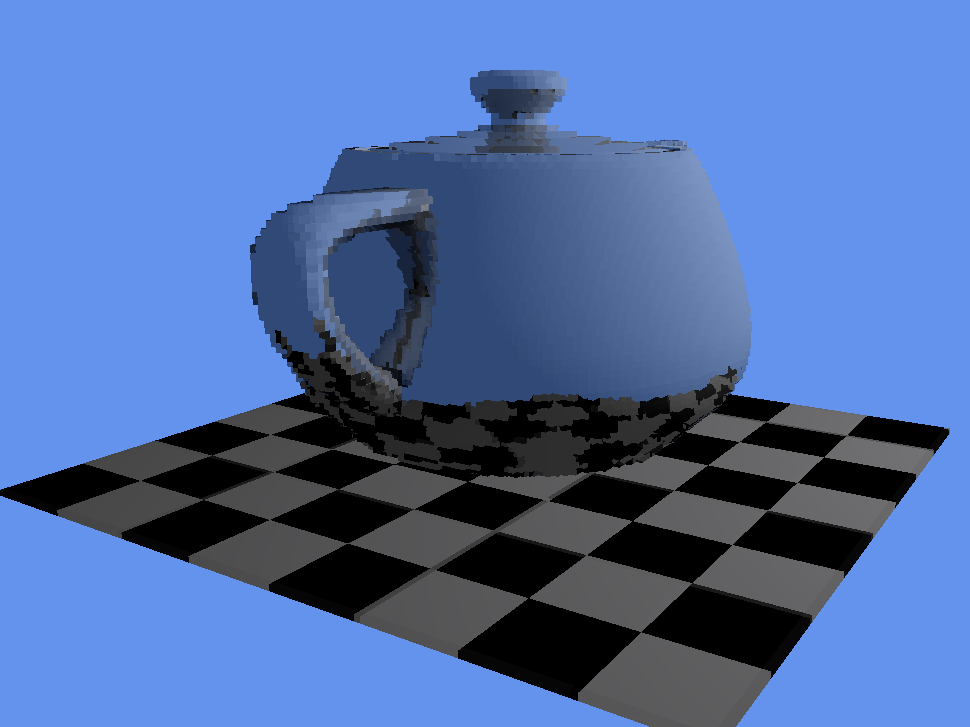</a>
<a href="Dissertation/images/translucent_teapot.PNG">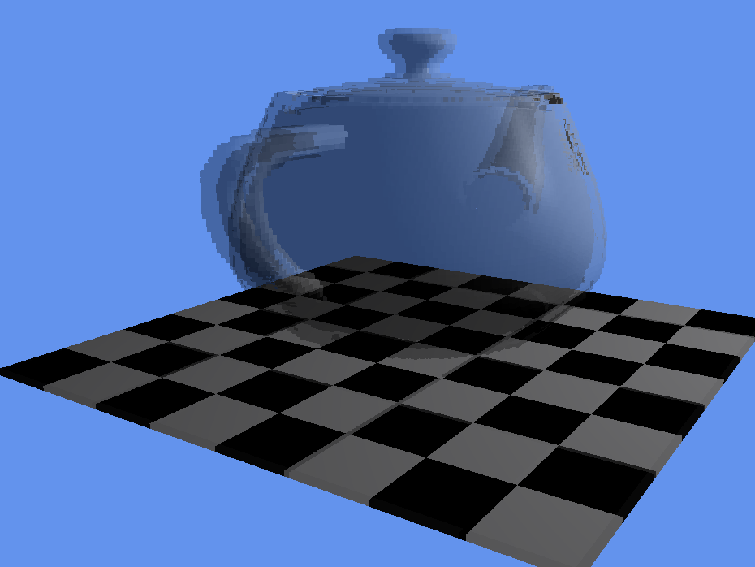</a>
<a href="Dissertation/images/fixed_reflection.PNG">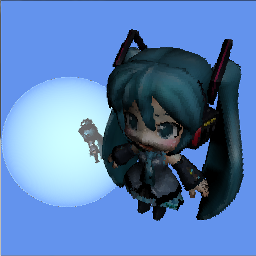</a>

A real-time ray tracer for volumes, written in C++ and CUDA, that can bend light through
see-through objects whose insides aren't the same all the way through. It was my
dissertation for my BSc in Computer Games Programming at the University of Derby, back in
2013-2014.

**📄 [Read the dissertation](https://cat.bio/dissertation.pdf)** (Real-time GPU Ray Tracing
with Volumetric Effects) · **▶ [Watch it running](https://www.youtube.com/watch?v=tK55MApXod0)**

GPUs are built for rasterisation, which only ever looks at the surfaces of things. That's
fine for most stuff, but loads of things in the real world are about what's *inside*: clouds,
water, smoke, glass with something in it. Games usually fake those with tricks like textured
quads and skyboxes. I wanted to see if you could actually model the volume and ray trace
through it, on a normal gaming GPU, in real time.

## How it works

The whole scene gets turned into a **sparse voxel octree**: a big cube that's split into 8
smaller cubes, which are split into 8 again, and so on, but only where there's actually
something there. Empty space is never stored, so you can go up to 2048³ voxels and still
fit it on the GPU.

Rays are traced through the octree on the GPU using the traversal algorithm from Laine and
Karras's [Efficient Sparse Voxel Octrees](https://research.nvidia.com/publication/2010-02_efficient-sparse-voxel-octrees)
(2010), which skips over empty space really quickly and never visits the same voxel twice.
Every pixel gets its own CUDA thread, which casts the primary ray and then any shadow,
reflection and refraction rays it needs, and writes straight into an OpenGL texture with
no trips back to the CPU.

The bit that's mine is what's inside the voxels. As well as a colour and a normal, each
voxel stores how reflective it is and its **index of refraction**, packed into 12 bytes. When
a ray goes into something see-through, it's bent using Snell's law, and then stepped through
the volume. Every time it moves into a voxel with a different index of refraction it gets
bent again, so light can refract through an object that changes inside (glass with a bubble
in it, say), not just off the outside of it.

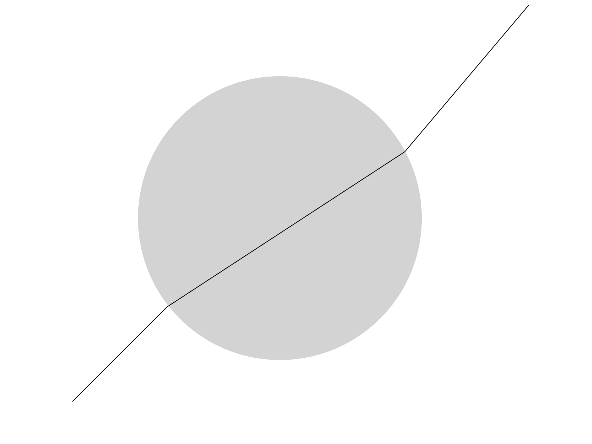 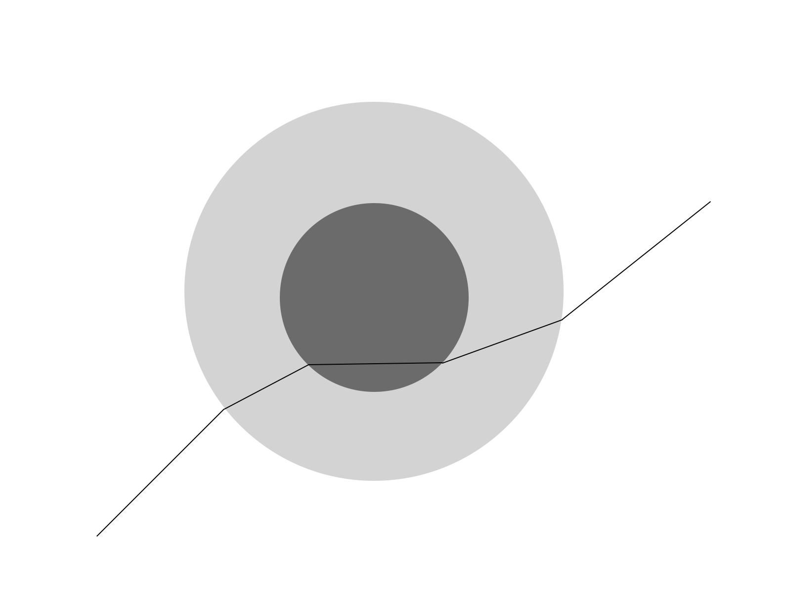

<sub>Left: refraction through the same material all the way through. Right: through a
material with a different one inside it, which is what this renderer can do.</sub>

## Results

Here's the test scene, a teapot on a checkerboard at 512³, with each effect switched on
in turn:

| No effects | Shadows | Reflection | Translucency |
|:-:|:-:|:-:|:-:|
| 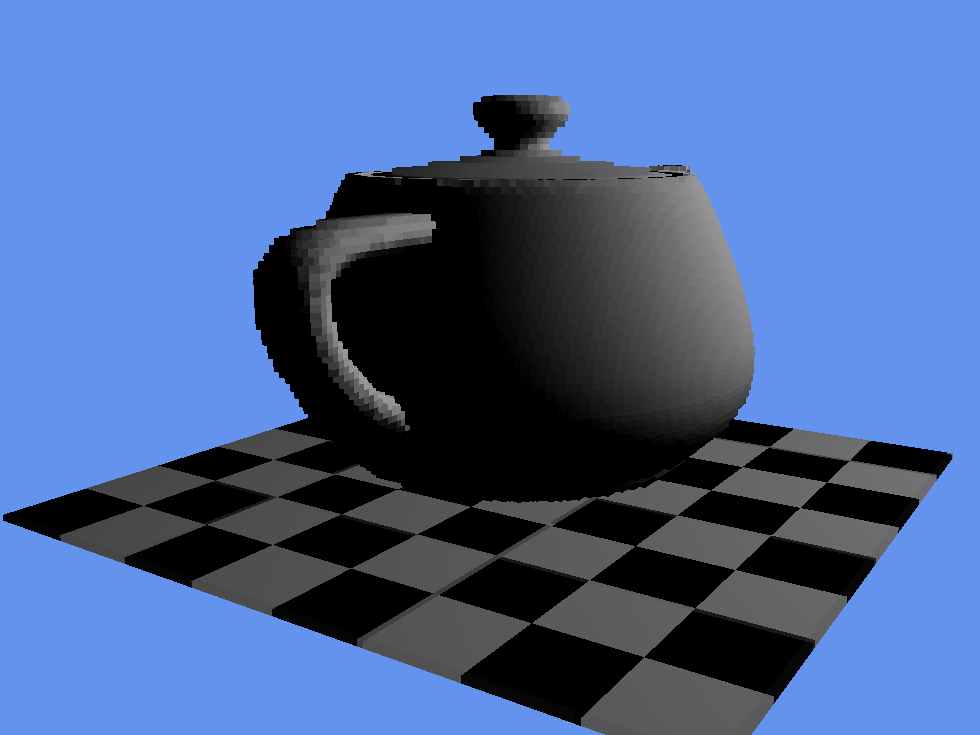 | 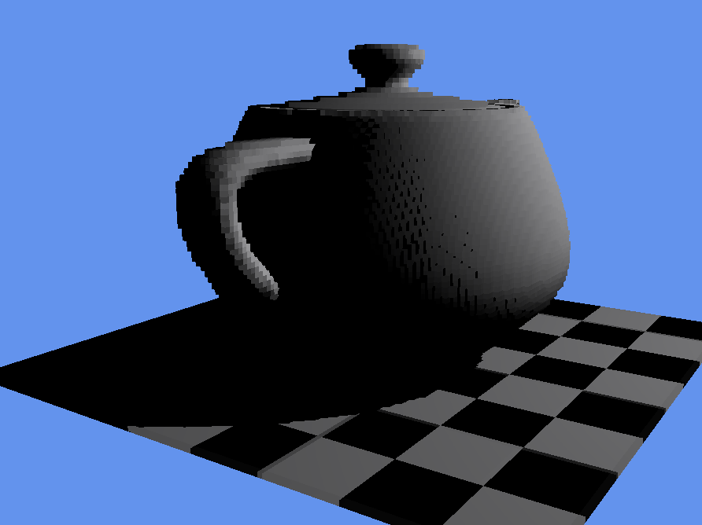 |  |  |

On a GTX 670 (a mid-range card in 2014), at 1024³:

| | 768x768 | 1024x1024 | 1920x1080 |
|---|--:|--:|--:|
| No effects | 85 fps | 54 fps | 26 fps |
| Shadows | 65 fps | 42 fps | 19 fps |
| Reflection | 59 fps | 38 fps | 17 fps |
| Translucency | 32 fps | 20 fps | 8 fps |

The octree scales really well with detail: every step up in resolution is 8 times as many
voxels, but only costs about 15% of the frame rate. Screen resolution is where it hurts.
Past about 1024x1024 the frame rate halves every time the pixel count doubles, and
translucency drops into single figures at 1080p. The full tables and graphs are in chapter
4 of the dissertation.

To check the refraction was doing the right thing, I rendered a glass ball with a hollow
middle next to one whose middle has an index of refraction of 1.0 (the same as air). They
should look identical, and they do:

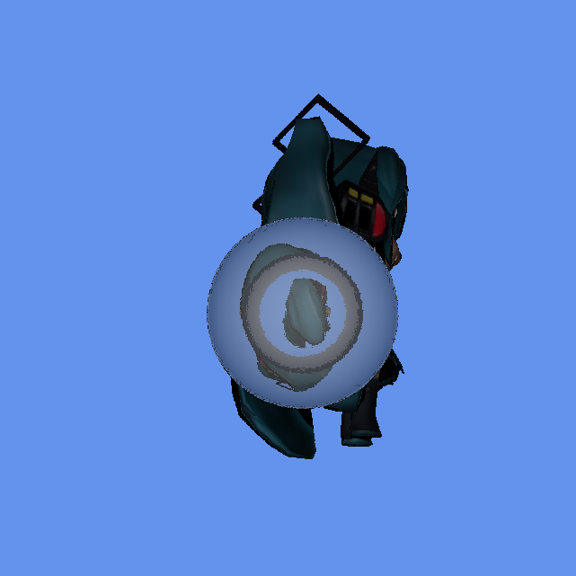 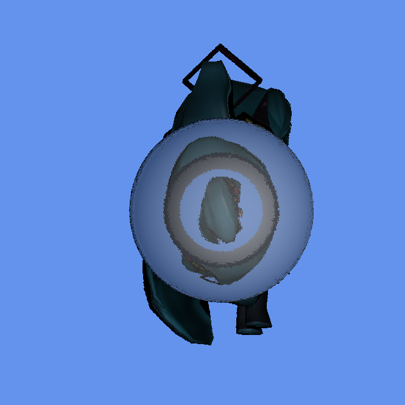

It also showed up a problem with voxels being cubes. A smooth sphere shouldn't be able to
shadow itself, but a sphere made of little cubes does, and you get dark speckles all over it
(and the same thing with reflections). Making the rays aware of surface normals fixes it,
but costs performance.

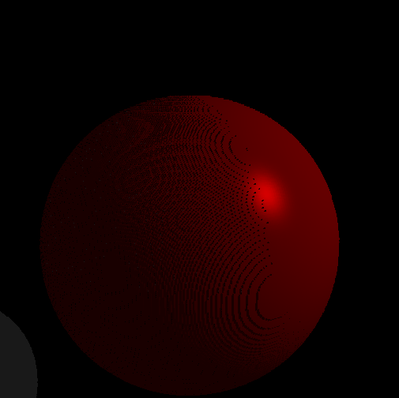 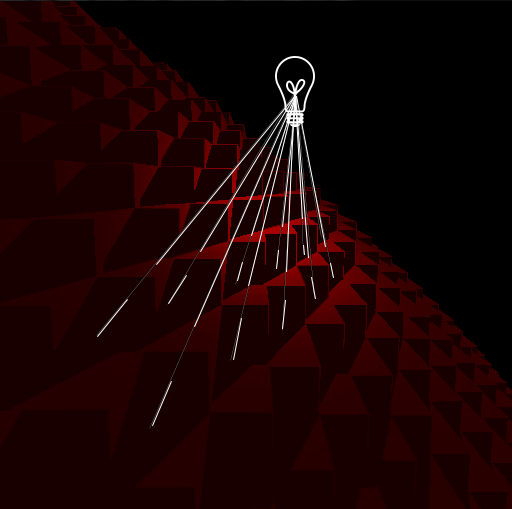

## What I'd do next

These are in the dissertation's conclusions, but the short version:

- **Better parallelisation.** One thread per pixel means a whole warp waits for its slowest
  ray, which is why translucency is so expensive. Persistent threads (Aila and Laine, 2009)
  that pull rays from a queue look like the fix.
- **Less memory.** Storing what's under the surface is the whole point, but it adds up fast:
  34 MB at 512³, 137 MB at 1024³ and 544 MB at 2048³. Sparse voxel DAGs (Kämpe et al.,
  2013) or Laine and Karras's contours should help a lot.
- **Smoother voxels.** Contours would also fix the self-shadowing, since the voxels at the
  surface wouldn't have to be cubes any more.
- **More kinds of volume.** This only does refraction. Scattering, the thing that makes
  clouds look like clouds, would be the next step.

## Building it

It's a 2014 Windows project: Visual Studio 2012 (the v110 toolset) and CUDA 6.0, built for
Fermi and Kepler GPUs. It'll need some updating to build with anything recent. The
dependencies (GLFW, GLEW, GLM, Assimp, FreeImage and Gwen) are in `dep/`, with their DLLs
in `dlls/`.

Open `VolumeRender.sln` and build. Run it from `dist/`, where the models are, either with
no arguments (it'll ask you) or with a scene number and an octree depth:

```
VolumeRender.exe 5 10
```

The scenes are: a sphere, a Miku model, Miku behind a glass ball (the two refraction test
balls are scenes 3 and 4), the teapot on a checkerboard, some boxes on a checkerboard, and
a teapot inside a mirrored cube (those last two need `cube.obj` and `inverted_cube.obj`,
which never made it into the repo). Scene 0 loads a `.tree` file made by `TreeGen`, which
voxelises any mesh. The deeper the octree the more detail, and about 8 is quick to generate.
Generated trees are saved next to the exe, so it's faster the next time.

### Controls

| Key | |
|---|---|
| L | Lock the mouse, to look around |
| W A S D, Q / E | Move, and down / up |
| 2 / 3 / 4 | Toggle shadows / reflection / refraction |
| 1 | Move the light to the camera |
| Esc | Quit |

## License

[BSD 2-Clause](LICENSE)
